<!-- ===================== HEADER ===================== -->

  

  

<!-- ===================== ABOUT ===================== -->

  

<!-- ===================== TECH STACK ===================== -->

  

<!-- ===================== STATS ===================== -->

  

  

  

<!-- ===================== TROPHIES ===================== -->

  

  

<!-- ===================== CONNECT ===================== -->

  

  
  
  

<!-- ===================== FOOTER ===================== -->

  

