<!-- ===================== HEADER ===================== -->

  

  

<!-- ===================== ABOUT ===================== -->

  

<!-- ===================== TECH STACK ===================== -->

  

<!-- ===================== LINKS ===================== -->

  
  
  

<!-- ===================== FOOTER ===================== -->

  

